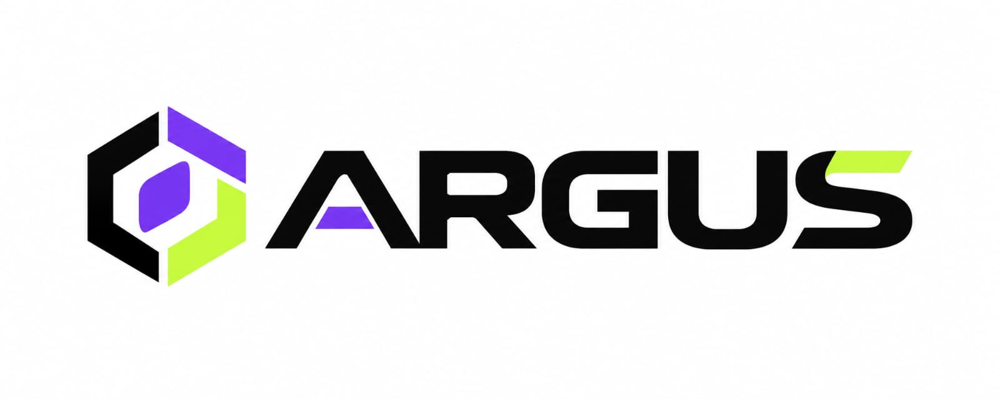

# Team Argus — BasicDrive (NRL HYPERDRIVE 2026)

**Author:** Dhruv aka [lostluffyz](https://github.com/lostluffyz) (dhruvjha.dhairya0@gmail.com)
**Team:** Argus — Team 012

A minimal, beginner-friendly TeleOp example for the NRL Hexa Command Hub (ESP32-S3).
Copy it into any NRL project and you have a driving robot in minutes. Shared so
other teams can get moving fast — good luck, and see you on the field!

## What it does

- **Tank drive** — left stick Y = forward/back, right stick X = turn.
- **One arm servo** (SERVO_1) — D-pad UP/DOWN nudges it 5° per press, X jumps to middle (90°).
- **Live telemetry** — arm angle shown on the controller.
- **Safe stop** — everything halts and the servo detaches on STOP.

## You need

- NRL SDK project (Hexa Command Hub robot + NRL controller, paired over ESP-NOW)
- 2× DC drive motors, 1× servo on SERVO_1
- VS Code + PlatformIO

## Use it

1. Copy `Argus.cpp` into your project's `RobotFirmware/opmodes/` folder.
2. In PlatformIO, **Build** then **Upload** to the robot.
3. On the controller, select **BasicDrive** from the menu, press INIT, then START.
4. If pushing the stick up drives you backwards, put a minus sign in front of
   `gamepad1.leftY()` (same idea for turning). The file has comments showing how.

## Notes

- This is a learning example, not our competition code — no tuning, no assists.
- Competition rule reminder: only files in `opmodes/` may be changed; the SDK
  engine, libraries and `RobotMain.ino` stay untouched.
- License: MIT (same as the NRL SDK) — free to use and share.
